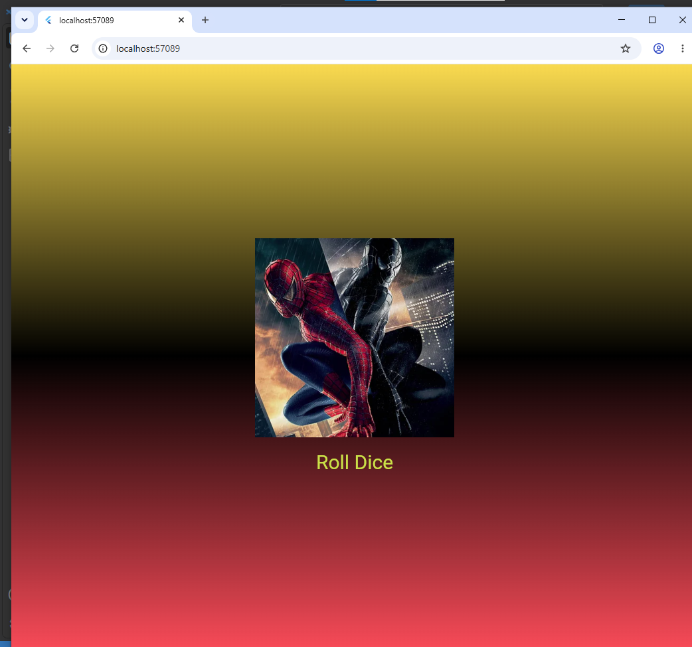

# Лабораторная работа №4-5. Flutter: структура UI и компонентный подход

приложение Roll Dice App на flutter — экран с градиентом и кнопкой, по нажатию на которую рандомно меняется картинка кубика

## Автор
Резник Анжелика Ильинична, группа ИСП-242, дата сдачи: 18.11.2026

## Скриншот приложения

## Ссылка на репозиторий
https://github.com/Anzhela2014/Flutter_Lab4

## Что изучили
* как строить интерфейс через дерево виджетов (`MaterialApp, Scaffold, Container, Column, Center`)
* как выносить свои виджеты в отдельные классы и файлы (`gradient_container.dart, dice_roller.dart`), чтобы не мешать всё в кучу
* как передавать параметры в конструктор виджета через `final`

## Ответы на вопросы

1. **Зачем выносить виджеты в отдельные файлы? Что изменится если держать всё в `main.dart`?**
чтобы код был понятным, читаемым и виджеты можно было легко переиспользовать в других местах. если держать всё в `main.dart`, файл быстро разрастётся, в нём станет неудобно искать нужный блок и править ошибки

2. **Что такое `BuildContext`? Почему метод `build()` принимает его как параметр?**
это объект, который хранит информацию о том, где именно виджет находится в общем дереве виджетов. `build()` принимает его, чтобы flutter понимал место виджета на экране и мог правильно его отрисовать или обновить

3. **Чем `StatelessWidget` отличается от `StatefulWidget`? Приведите пример когда нужен каждый из них.**
`StatelessWidget` не хранит состояние и не перерисовывается сам по себе (только при пересоздании), а `StatefulWidget` хранит изменяемые данные в объекте `State` и обновляет интерфейс при вызове `setState()`.
* `StatelessWidget` нужен для статичных элементов — например, фон с градиентом, логотип или обычный текст заголовка.
* `StatefulWidget` нужен там, где что-то меняется по действию пользователя — например, счётчик кликов или наш кубик, у которого меняется картинка при нажатии на кнопку.

4. **Почему `Random()` создаётся на уровне файла, а не внутри `rollDice()`?**
если создавать `Random()` внутри `rollDice()`, то при каждом клике по кнопке в памяти будет создаваться новый генератор, а старый удаляться. вынести его на уровень файла эффективнее, потому что один объект создаётся один раз и используется повторно

## Запуск
1. клонировать репозиторий:
   `git clone https://github.com/Anzhela2014/Flutter_Lab4`
2. перейти в папку проекта:
   `cd Flutter_Lab4`
3. запустить в браузере:
   `flutter run -d chrome`
